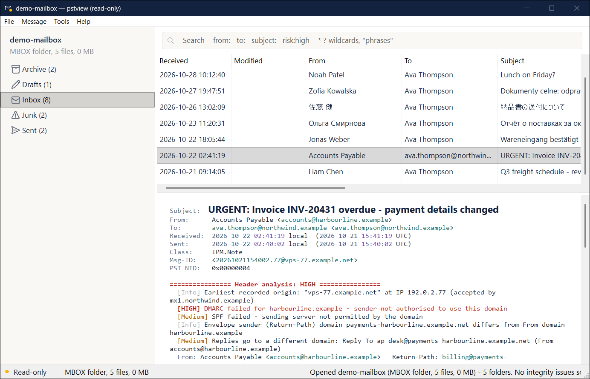

# pstview

A small, read-only viewer and exporter for Outlook `.pst` / `.ost` files and MBOX mailboxes, with offline header analysis and recovery of deleted items. Written in Zig with no third-party dependencies; the GUI and the command-line tool run on Windows, macOS and Linux.

Built for evidence work: sources are opened **read-only** and never written to, and nothing (no index or cache file) is created next to them. Outlook, by contrast, modifies a data file as soon as it opens one, and locks its OSTs while running: close Outlook or work on a copy.



*The fictional demo mailbox in [`testdata/demo-mailbox`](testdata/demo-mailbox); all names, domains and addresses are made up.*

## Programs

| Program | What it is |
|---|---|
| `pstview` (`pstview.exe`, `pstview.app`) | GUI, the same on every platform: folder tree, sortable / searchable message list, and a reading pane with tabs (*Message*, *Header analysis*, *Internet headers*, *Attachments*). Double-click or Enter opens a message in its own window. Open a source with *File > Open*, by dropping it on the window, from the command line, or with *Open with*. |
| `pstx` (`pstx.exe`) | Command line: `tree`, `list`, `show`, `export`, `topst`, `hash`, `hidden`, `verify`, `search`, `triage`, `headers`, `props`, `recover`, `analyse`. |

Release archives hold both programs: `windows-x64`, `linux-x64`, `linux-arm64`, `macos-arm64`, `macos-x64`.

**Requirements.** `pstx` needs nothing. The GUI shows its content in the web view that is part of the operating system, so there is no bundled browser engine:

* **Windows:** the WebView2 runtime (part of Windows 11 and of up-to-date Windows 10).
* **macOS:** 11 or later. The app is ad-hoc signed, not notarised: after unpacking run `xattr -dr com.apple.quarantine pstview.app pstx`, or allow it in *System Settings > Privacy & Security*.
* **Linux:** GTK 3 and WebKitGTK, which most desktops have (`libgtk-3-0 libwebkit2gtk-4.1-0` on Debian / Ubuntu, `gtk3 webkit2gtk4.1` on Fedora, `gtk3 webkit2gtk-4.1` on Arch).

pstview warns when its web view is missing.

## Portable or installed

pstview runs from the release archive. *Help > Install pstview for this user* installs it, *Help > Uninstall pstview* removes itself. No administrator or root rights are needed.

* **Windows:** `%LOCALAPPDATA%\Programs\pstview`, a Start menu shortcut, *Open with* handlers for `.pst`, `.ost`, `.mbox`, `.mbx`, and an entry in *Settings > Apps*; everything per user under `HKCU`. A portable copy offers to install when it starts; *Don't offer this again* stores only that choice.
* **Linux:** `~/.local/bin`, plus a menu entry, the icon and a file type for `.pst` / `.ost` under `~/.local/share`. Also `pstview --install` and `pstview --uninstall`.
* **macOS:** a copy of `pstview.app` in `~/Applications`. The default app is chosen in Finder (*Get Info > Open with > Change All*).

## Safe viewing

* The HTML is sanitised: scripts, frames, forms, event handlers and `javascript:` URLs are removed.
* Remote images and CSS are replaced and counted, so no tracking pixel is fetched; `cid:` images are embedded from the attachments.
* A Content-Security-Policy forbids scripts and network access, and the message sits in a sandboxed frame where no script runs.
* The mail's own CSS is confined to the mail, so a message can neither restyle nor cover the header block above it.
* Every navigation and new window is refused (a link in a message leads nowhere), and the web view keeps no profile.
* Attachments are never opened. Text and PNG / JPEG / GIF / BMP / WebP images can be viewed in place; anything else can only be saved.

pstview follows the system's light or dark setting, and *View > Theme* switches it for the session. HTML mail is always laid out on white, as emails are not usually desiged for dark backgrounds.

## Header analysis

A message-header analyser, built in and **fully offline**: no DNS, reputation or geo-IP lookups. Use the *Header analysis* tab, *Message > Header analysis report* (Ctrl+I) for the full report, or *Tools > Analyse pasted headers / headers from .eml or .txt file* for headers copied from anywhere. The report shows:

* **Verdict and findings:** spoofing, impersonation of internal users, lookalike domains, Reply-To diversion, failed authentication, phishing / spam verdicts of the receiving service, delays and clock skew.
* **Authentication:** SPF, DKIM and DMARC as recorded on first arrival in the receiving organisation (mail gateways re-inject mail, and later re-checks fail by design), SPF and DKIM alignment with the From domain, pstview's own DMARC evaluation, and every authentication result, DKIM signature and ARC chain.
* **Delivery path:** every hop with host, IP, protocol, TLS version, per-hop delay, and negative delays flagged as clock skew.
* **Filtering:** anti-spam and filtering headers of the common mail services and gateways, decoded and explained.
* **Indicators:** all IP addresses, hosts, domains, e-mail addresses and URLs in the headers, with the header each came from.

*Tools > Analyse headers in this folder* (Ctrl+R) runs the triage part over a whole folder and sorts by risk.

## Hidden, deleted and recovered items

* **Hidden-item scan** (automatic, *[Hidden items]* branch, `pstx hidden`): messages that no folder lists, folder-associated items such as rules and views, and folders not reachable from the tree.
* **Recover deleted items** (*Tools > Recover deleted items*, `pstx recover`): Outlook writes changed index pages elsewhere and frees the old ones, which usually stay in the file. pstview finds the valid stale pages and recovers what they list: items **no longer indexed** (deleted or moved) and **earlier versions** of existing items. An item is recovered only when its data blocks still pass their checksums. Each item's *Note* names the stale page and the folder it was in. The approach follows libpff's `pffrecover` (*Personal Folder File forensics*, J. Metz).
* **Server-side deletions:** a *Recoverable Items* folder (present in eDiscovery and server exports) is labelled in the tree.
* **Thunderbird:** messages flagged as deleted but not yet compacted are listed and marked.

## Multi-file PST sets

Open several PST / OST files together (multi-select in *File > Open*, drop them on the window, open their folder, or `pstx ... "a.pst;b.pst"`) and they are shown as **one mailbox**. Same-path folders are combined, each item's *Note* names its part, and items found in more than one part are flagged as duplicates, not hidden. Every part stays a separate read-only file: verification, the integrity log and SHA-256 hashes are reported per part.

## Convert to PST

*File > Export whole mailbox as PST* (`pstx topst <source> <out.pst>`) writes everything in the user's folders to a new Unicode PST that Outlook can open: the way to turn an OST, an MBOX export or a set of PST parts into one PST.

* **Kept:** the folder tree, every message with all its properties (named properties are re-mapped to the new file's name map, so calendar, contact and task fields keep working), recipients, attachments byte for byte, and embedded messages. A top-level *Deleted Items* becomes the new file's Deleted Items.
* **Filled in when the source lacks them:** the properties every PST item must have (message class, flags, size, status, creation and modification times, search key). MBOX messages carry no modification time; the delivery time is used.
* **Left out:** the source file's own entry ids and keys, search folders, views and other folder-associated items, and the *[Hidden]* / *[Recovered]* branches.
* **Safe for evidence:** the source is only read, and the target may not be one of its files. The PST is written under a temporary name and renamed when complete, so a failed export leaves no plausible-looking file. The output is deterministic (no clock, no random numbers): the same source, named by the same path, gives the same file (the path seeds the new file's provider id; the GUI uses the absolute path). `<name> report.html` / `.csv` beside it list every item with its new node id, and the SHA-256 of the source and of the new PST.

The writer follows [MS-PST] (Unicode, 512-byte pages, no encryption); where the specification leaves a detail open it follows Outlook's own files. CI reads every written test file back with pstview's reader (every page and block checksum); during development the files were also checked with libpff. They have not been opened by Outlook in this project's test runs: please report any file Outlook or *scanpst.exe* complains about. Files over 2 GB contain one more kind of map page whose position [MS-PST] does not state; it follows an existing open-source PST writer and is the least-tested part.

## Formats

* **PST / OST:** Unicode files, unencrypted or with "compressible" encryption, in both page sizes (512-byte pages of Outlook 2003+; 4 KiB pages with zlib-compressed blocks of Outlook 2013+ OSTs). Compressed RTF bodies are decoded. Not yet supported: ANSI (97-2002) files and "high" encryption.
* **MBOX:** any mbox file (mboxo / mboxrd, LF or CRLF), and these layouts: a Google Takeout export (labels become folders), a Thunderbird mail folder (`.sbd` subfolders), and Apple Mail `.mbox` bundles. Messages are decoded from MIME in any charset.
* **Item types:** mail, appointments and meetings, contacts and distribution lists, tasks, notes and journal entries, with their fields. *Message > All properties* (`pstx props`) lists every MAPI property of an item.
* **Export:** `.pst` (whole mailbox, see above), `.msg` (written directly, no Outlook needed) and `.eml`. An `.eml` from an MBOX is the original message, byte for byte; one from a PST keeps the original internet headers and adds `X-PST-*` provenance headers.

Every export writes `pstview report.html` and `pstview report.csv`: source path, size, format and SHA-256, and each item's dates, sender, recipients, subject, attachments and file name. Dates are in local time with daylight saving applied per date. CSV values a spreadsheet would run as a formula get a leading apostrophe.

## pstx examples

```
pstx tree    backup.pst
pstx list    backup.pst "Inbox"
pstx show    backup.pst 00200044 --html msg.html    # the GUI's sanitised view, as a page
pstx export  backup.pst "Sent Items" out eml --match "contract"
pstx export  backup.pst 0x8462 out msg --modified 2026-11-05
pstx topst   backup.ost converted.pst               # OST (or MBOX, or PST parts) to a new PST
pstx hash    backup.pst
pstx verify  backup.ost                             # close Outlook first
pstx headers backup.pst 00200044 --html hdr.html    # header analysis of one message
pstx analyse suspicious.eml --html hdr.html         # headers of a saved message, no mailbox needed
pstx tree    "export parts"                         # a folder of PST parts, merged
pstx recover backup.ost
```

Folders are named by path or by the NID that `tree` prints; messages by the NID that `list` prints. `pstx` exits with 0 when the command did what was asked and 1 otherwise; an export continues past an item that fails and lists the failures.

## Build

Requires Zig 0.17.1 or newer.

```
zig build -Drelease                               # pstview and pstx in zig-out/bin
zig build test                                    # unit tests, and each fuzz target once
zig build fuzz -Doptimize=ReleaseSafe --fuzz=10K  # coverage-guided fuzzing of untrusted content
zig build -Drelease -Dtarget=x86_64-linux-musl    # static pstx; a musl build has no GUI
zig build -Drelease -Dtarget=aarch64-macos        # any target cross-compiles from any host
```

The web view is loaded at run time on every platform, so no SDK or development package is needed. `packaging/macos/make-app.sh` wraps the macOS binaries in `pstview.app`.

CI builds every push on Windows, macOS and Linux, checks that `pstx` prints identical output everywhere (including a PST written from the demo mailbox, byte for byte), and runs the GUI self-test (`pstview --selftest <source>`). Pushing a `v*` tag publishes a release with the archives and `SHA256SUMS.txt`; the tag must match `release_version` in `build.zig`.

## Source layout

* `src/pst.zig`, `rtfcp.zig`, `namemap.zig`, `itemview.zig`, `propview.zig`, `recover.zig`: PST / OST reader, compressed RTF, named properties, item fields, property list, recovery.
* `src/mbox.zig`, `mime.zig`, `multi.zig`, `store.zig`: MBOX reader, MIME parsing, merged multi-file mailboxes, one interface over all sources.
* `src/headers.zig`, `headerreport.zig`, `search.zig`: header analysis, its reports, and search.
* `src/render.zig`, `export.zig`: the sanitised message view; EML / MSG writers and reports.
* `src/pstwrite.zig`: the PST writer (NDB blocks and B-trees, heaps, property and table contexts, folders and messages).
* `src/webui.html`, `webapp.zig`: the GUI shared by all platforms (the page and the model behind it).
* `src/gui_win.zig`, `gui_mac.zig`, `gui_gtk.zig`, `gui_posix.zig`: windows, web views and dialogs per platform.
* `src/setup.zig`, `install.zig`: per-user install and uninstall.
* `src/cli.zig`, `platform.zig`, `fuzz.zig`: command line, time zone and charset conversion, fuzz targets.

## References

[MS-PST]: Outlook Personal Folders (.pst) File Format
https://learn.microsoft.com/en-us/openspecs/office_file_formats/ms-pst/141923d5-15ab-4ef1-a524-6dce75aae546

libpff
https://github.com/libyal/libpff
